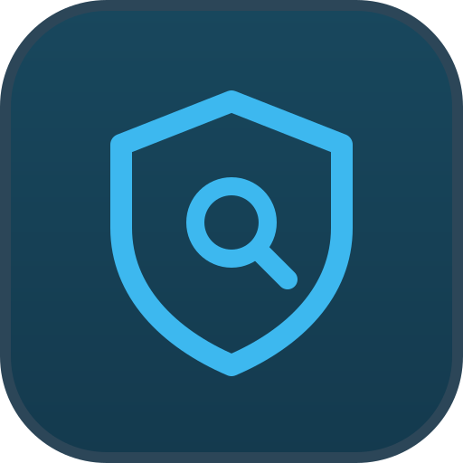

# FocusGuard

<div align="center">

 **FocusGuard by [Quasim.](https://linkedin.com/in/quasimkhan)**

<br/><br/>

[](https://github.com/quasimkhan/FocusGuard/releases/latest)
[](https://github.com/quasimkhan/FocusGuard/releases/latest)
[-FFC66D?style=for-the-badge&labelColor=111B25)](https://github.com/quasimkhan/FocusGuard/releases/latest)
[](LICENSE)

<br/>

**A zero-bloat, 100% on-device Android distraction blocker, short-form video filter, local DNS adult firewall, and focus study lock with best-effort tamper friction.**

<br />

[**🌐 Live Website**](https://quasimkhan.github.io/FocusGuard/) ·
[**⬇️ Direct APK**](https://github.com/quasimkhan/FocusGuard/releases/latest) ·
[**📱 Indus Appstore**](https://indusapp.store/9o4g51w8) ·
[**📦 APKPure**](https://apkpure.com/p/com.focusguard.app) ·
[**🔄 Obtainium**](https://apps.obtainium.imranr.dev/redirect?r=obtainium://add/https://github.com/quasimkhan/FocusGuard) ·
[**📖 User Wiki**](https://github.com/quasimkhan/FocusGuard/wiki)

</div>

---

## Why FocusGuard?

Most blockers require subscriptions, cloud accounts, or invasive analytics.

**FocusGuard** runs every shield locally inside your phone's memory, giving you precise control over attention traps without slowing down your device or sending personal data off your phone.

| Core Engine | Capabilities & Protection |
| :--- | :--- |
| **Surgical Shorts & Reels Filter** | Automatically exits **YouTube Shorts** and **Instagram Reels** the moment they open, while keeping long-form lectures, search, subscriptions, and DMs working normally. |
| **3-Mode App Control** | Assign every installed app to **Open**, **15s Pause**, or **Block**. The 15-second pause enforces a mindful breathing prompt before unlocking a temporary 5-minute pass. |
| **On-Device Web & Adult Shield** | Local loopback DNS firewall (**IPv4 + IPv6**) blocking **130,000+ adult domains**, rotating mirror sites, and custom wildcard rules across Chrome, Brave, Firefox, and Incognito tabs—with zero external VPN servers or internet slowdown. |
| **Study OS** | Built-in Deep-Work Pomodoro timer (**25m · 50m · 90m**) with daily focus tracking, plus a recurring **Daily Auto-Lock Window** with an independent, add-only app list while active. |
| **Anti-Impulse Armor** | Best-effort tamper friction while Accessibility is enabled, plus monotonic cooldown timers (**15m to 7d**) anchored to Android's uptime clock so changing device time cannot bypass active locks. |
| **100% Private & Open Source** | Written in native **Kotlin & Jetpack Compose**. Zero accounts, zero analytics SDKs, zero ads—openly available under the [MIT License](LICENSE). |

---

## Download & Install on Android

> **Distribution Note:** Because FocusGuard uses Android Accessibility and local VPN APIs for system-wide blocking, it is distributed via verified GitHub Releases, Indus Appstore, APKPure, and Obtainium rather than the Google Play Store.

### Official Download Channels

| Channel | Best For | Link |
| :--- | :--- | :--- |
| **GitHub Releases (Direct APK)** | Verified primary release signed by `Quasim.™` | [**Download Latest APK**](https://github.com/quasimkhan/FocusGuard/releases/latest) |
| **Indus Appstore (PhonePe)** | One-tap install and store updates in India | [**Get on Indus Appstore**](https://indusapp.store/9o4g51w8) |
| **APKPure** | Alternative store mirror for `com.focusguard.app` | [**Get on APKPure**](https://apkpure.com/p/com.focusguard.app) |
| **Obtainium** | Automatic in-place updates directly from GitHub | [**Add to Obtainium**](https://apps.obtainium.imranr.dev/redirect?r=obtainium://add/https://github.com/quasimkhan/FocusGuard) |

---

## First-Time Android Setup Guide

### Step 1: Install the APK

1. Open the [**Latest Release Page**](https://github.com/quasimkhan/FocusGuard/releases/latest) on your Android phone, or use **Indus Appstore** or **APKPure**.
2. Under **Assets**, tap `FocusGuard-<version-tag>-Quasim.apk`.
3. Open the downloaded `.apk` file and tap **Install**.
4. If prompted, grant **Install unknown apps** permission to your browser or file manager.

### Step 2: Enable the Accessibility Engine (Android 13–16)

1. Open **FocusGuard** and tap **Open Accessibility settings** on the *Accessibility Service Offline* banner.
2. Under **Downloaded apps**, tap **FocusGuard**.
3. If FocusGuard is greyed out with a **Restricted setting** message:
   - Open **Phone Settings → Apps → FocusGuard**.
   - Tap the three-dot menu (`⋮`) in the top-right corner.
   - Select **Allow restricted settings** and authenticate with your PIN or fingerprint.
4. Return to **Settings → Accessibility → FocusGuard**.
5. Switch **Use FocusGuard** to **ON**.

### Step 3: Keep FocusGuard Running in the Background

Android phone manufacturers aggressively stop background services unless they are exempted.

1. Long-press the **FocusGuard** icon on your home screen.
2. Tap **App info**.
3. Set **Battery** to **Unrestricted / No restrictions**.
4. On **Xiaomi / POCO / Redmi / Realme / Vivo / Oppo**, also turn **Autostart** **ON**.

### Step 4: Activate Web Shield & Armor Protection

1. Open the **Web** tab in FocusGuard.
2. Switch **Block Adult Contents (Local DNS Shield)** to **ON**.
3. Tap **OK** on Android's local VPN connection prompt.

   **Chrome Tip:** Open **Chrome Settings → Privacy and security → Use secure DNS** and turn it **Off** so Chrome routes DNS lookups through FocusGuard's local shield.

4. In **Armor**, optionally enable the **Device Admin** warning.

   Regular Device Admin enrollment cannot guarantee uninstall prevention. While a focus lock is active and Accessibility is enabled, FocusGuard attempts to dismiss a clearly identified FocusGuard uninstall confirmation. Some OEM installer screens do not expose enough information and may fail open.

---

## Daily Auto-Lock Window & Notifications

Open **Study OS**, enable **Daily Auto-Lock Window**, set the **Start Time** and **End Time**, then search and select the apps for this schedule.

- **Independent Schedule List:** This list is separate from the global `Open` / `15s` / `Block` modes in the **Apps** tab. Schedule-only apps remain usable outside the window, while any global rule remains in effect.
- **Boundary Rules:** The start minute is included, and the end minute is excluded. Overnight windows, such as `22:00` to `06:00`, are supported. Matching start and end times enforce all day.
- **Exact Alarms (Android 12+):** Allow **Alarms & reminders** access in Study OS for precise mid-session transitions and boundary alerts. If unavailable, FocusGuard still checks the schedule whenever a foreground app changes, though an already-open app and its alert may update late.
- **Focus Notifications (Android 13+):** Enabling the schedule or **Comic Focus Nudges** prompts for notification permission. Choose **Not now** to keep using FocusGuard silently—blocking still remains active. You can verify or toggle individual channels (**Daily Auto-Lock**, **App Block**, **Comic Nudge**) anytime in **Android App info → Notifications**.

---

## Automatic In-App Updates

FocusGuard checks GitHub Releases automatically every 24 hours, or manually via **Armor → Check Updates**.

Whenever a newer release is published, an **Update Available** banner appears at the top of the dashboard.

Tap **Download** and install the signed APK directly over your existing app without losing any blocklists, schedules, or focus stats.

---

## Building & Releasing from Source

<details>
<summary><strong>Local Builds & Automated GitHub Actions CI</strong></summary>

### Local Builds

Debug builds require no signing setup:

```bash
./gradlew --no-daemon testDebugUnitTest assembleDebug
```

Release builds require the following credentials:

- `RELEASE_STORE_FILE`
- `RELEASE_STORE_PASSWORD`
- `RELEASE_KEY_ALIAS`
- `RELEASE_KEY_PASSWORD`

Supply them through user-level Gradle properties (`~/.gradle/gradle.properties`) or CI environment variables.

**Keep these credentials and your keystore outside the repository.**

### Automated Production Releases

Pushing an annotated `vMAJOR.MINOR.PATCH` tag triggers `.github/workflows/release.yml`, which:

1. Verifies that the Git tag matches `versionName` and the version-code formula:

   `MAJOR × 10000 + MINOR × 100 + PATCH`

2. Executes:

   ```bash
   ./gradlew --no-daemon testDebugUnitTest assembleRelease
   ```

3. Signs the APK as `FocusGuard-v<version>-Quasim.apk` and publishes it as the repository's latest GitHub Release.

### Configure GitHub Actions Secrets

Configure these repository Actions secrets before cutting a release:

| Secret | Description |
| :--- | :--- |
| `KEYSTORE_BASE64` | Release `.jks` keystore encoded as Base64 |
| `RELEASE_STORE_PASSWORD` | Keystore password |
| `RELEASE_KEY_ALIAS` | Signing key alias |
| `RELEASE_KEY_PASSWORD` | Signing key password |

### Create and Push a Release Tag

```bash
git tag -a v1.5.2 -m "FocusGuard 1.5.2"
git push origin main v1.5.2
```

</details>

---

## Documentation, Support & Contact

- **Official Website:** [quasimkhan.github.io/FocusGuard](https://quasimkhan.github.io/FocusGuard/)
- **Documentation & Troubleshooting Wiki:** [github.com/quasimkhan/FocusGuard/wiki](https://github.com/quasimkhan/FocusGuard/wiki)
- **Privacy Policy:** [PRIVACY.md](PRIVACY.md)
- **Report a Bug / Request a Feature:** [Open a GitHub Issue](https://github.com/quasimkhan/FocusGuard/issues)
- **Email:** quasimdotdev@gmail.com
- **X (Twitter):** [@quasimdotdev](https://x.com/quasimdotdev)
- **LinkedIn:** [linkedin.com/in/quasimkhan](https://linkedin.com/in/quasimkhan)

---

<div align="center">

Released under the MIT License · Crafted in Native Kotlin by **Quasim.™**

</div>
